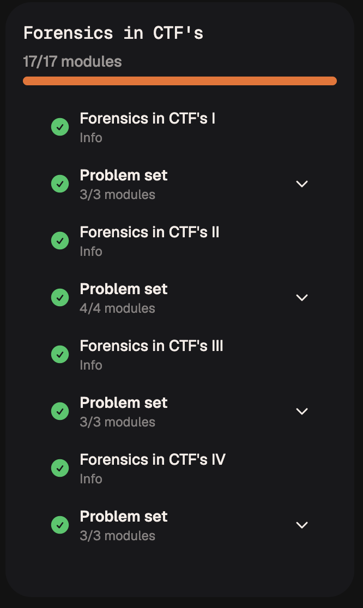

**Event / Platform:** PicoCTF | **Category:** Digital Forensics | **Difficulty:** Medium  
**Author:** ksngstr | **Status:** Solved  
**Flag:** `academy{REDACTED}`

---

## 1. Challenge Overview & Objectives
* **Prompt Description:** > "Figure out how they moved the flag. tftp.pcapng"
* **Core Questions Answered:**
  1. **What are some other ways to hide data?** Combining classical substitution ciphers (ROT-13) with image steganography (`steghide`) over an unencrypted transport protocol (TFTP).
  2. **Based on the title, what files are transferred?** Six files transferred via Trivial File Transfer Protocol (TFTP): `instructions.txt`, `plan`, `program.deb`, `picture1.bmp`, `picture2.bmp`, and `picture3.bmp`.
  3. **Where is the flag hidden?** Embedded inside `picture3.bmp` using `steghide` and protected with a passphrase recovered from the network traffic.

---

## 2. Provided Artifacts & Integrity Verification

| File Name | File Type / Magic Bytes | Size | SHA-256 Hash |
| :--- | :--- | :--- | :--- |
| `tftp.pcapng` | `pcapng capture file` | `50 MB` | `11b8fa4469bcdc8dd62140ee71621c526d8b4d04b7b6b5304053171bb0c04903` |

---

## 3. Environment & Tooling
* **OS / Analysis VM:** Kali Linux
* **Tools Used:** `Wireshark`, `CyberChef`, `binwalk`, `strings`, `exiftool`, `steghide`, `zsteg`, [dCode.fr](https://dcode.fr), [Aperi'Solve](https://aperisolve.com)

---

## 4. Investigation Log & Confirmed Findings

### Step 1: Initial Triage
* **Commands Run:**

  ```
  $ file tftp.pcapng
  $ exiftool -a -u -g1 -ee3 -api RetrieveAll=3 tftp.pcapng
  $ strings -n 8 tftp.pcapng | grep -i "academy"
  ```

* **Findings:** Confirmed a valid `pcapng` network capture. No plaintext flag strings were present in the raw packet data.

### Step 2: Network Traffic & TFTP Extraction (Wireshark)
* **TFTP Write Request (`instructions.txt`):**
  * *Observation:* Packet 3 is a TFTP transfer from `10.10.10.11:34790` to `10.10.10.12:52355`.
  * *Extracted Data:* Identified ROT-13 ciphertext and decoded it using [dCode ROT-13](https://dcode.frrot-13-cipher):
  
    > `TFTP DOESNT ENCRYPT OUR TRAFFIC SO WE MUST DISGUISE OUR FLAG TRANSFER. FIGURE OUT A WAY TO HIDE THE FLAG AND I WILL CHECK BACK FOR THE PLAN`
* **TFTP Read Request (`plan`):**
  * *Observation:* Packet 20 revealed a 59-byte TFTP data transfer from `10.10.10.12:41165` to `10.10.10.11:44157`.
  * *Extracted Data:* Decoded the ROT-13 ciphertext to reveal the steganography passphrase (`[REDACTED]`):
  
    > `I USED THE PROGRAM AND HID IT WITH - [REDACTED]. CHECK OUT THE PHOTOS`
* **Bulk Object Extraction:**
  * *Action:* Used **File > Export Objects > TFTP** in Wireshark to extract all transferred files (`instructions.txt`, `plan`, `program.deb`, `picture1.bmp`, `picture2.bmp`, and `picture3.bmp`) to a local working directory.

### Step 3: Package & Steganography Analysis
* **Debian Package Inspection (`program.deb`):**
  * *Observation:* Ran `binwalk -Mek program.deb` (or `dpkg -I program.deb`) to identify the software transferred over TFTP.
  * *Finding:* Confirmed the package was `steghide`, indicating the exact tool used to embed data into the BMP images.
* **Image Triage (`picture1.bmp` – `picture3.bmp`):**
  * *Observation:* Standard metadata (`exiftool`) and `strings` checks returned no anomalies. Running `zsteg -a` flagged potential OpenPGP/binary data at the end of `picture3.bmp`, confirming hidden payload presence.

---

## 5. Solution & Flag Extraction

### Step-by-Step Solve Path
1. Open `tftp.pcapng` in **Wireshark** and extract all TFTP objects via **File > Export Objects > TFTP**.
2. Decode the contents of `instructions.txt` and `plan` using ROT-13 to uncover the passphrase (`[REDACTED]`).
3. Inspect `program.deb` with `binwalk` to confirm `steghide` was used to hide the payload.
4. Extract the hidden flag file from `picture3.bmp` using `steghide`:

   ```bash
   $ steghide extract -sf picture3.bmp -p [REDACTED]
   ```
   
5. Read the extracted `flag.txt` file to obtain the final flag.

### Decoded Flag
```text
academy{REDACTED}
```

---

## 6. MITRE ATT&CK® Framework Mapping

| Tactic | Technique ID | Technique Name | Challenge Behavior Observed |
| :--- | :--- | :--- | :--- |
| **Defense Evasion** | `T1027` | Obfuscated Files or Information | Encoding operational communications (`instructions.txt` and `plan`) using ROT-13 to avoid casual plaintext inspection. |
| **Defense Evasion** | `T1027.003` | Obfuscated Files or Information: Steganography | Embedding the flag inside an uncompressed bitmap image (`picture3.bmp`) via `steghide` with passphrase protection. |
| **Command and Control** | `T1105` | Ingress Tool Transfer | Transferring the `steghide` Debian installer (`program.deb`) across the network to stage the steganography utility. |
| **Exfiltration** | `T1048.003` | Exfiltration Over Alternative Protocol: Exfiltration Over Unencrypted Non-C2 Protocol | Using cleartext UDP-based TFTP to move the steganographically disguised flag out of the environment. |

---

## 7. Key Takeaways & Lessons Learned
* **Protocol Awareness:** TFTP transmits files in cleartext over UDP, making Wireshark's **Export Objects** feature the fastest way to reconstruct transferred payloads.
* **Tool Correlation:** Always inspect accompanying binaries or installers (`program.deb`) in a capture—they directly reveal the encoding or steganography tool used by the threat actor.
* **Read Clues Carefully:** The passphrase was hidden in plain sight inside the decoded `plan` message rather than requiring brute-force cracking.
* **Steganography Tooling:** While `zsteg` is great for detecting LSB anomalies and appended data in PNG/BMP files, `steghide` uses a pseudo-random bit-distribution algorithm that requires the matching tool and passphrase for extraction.

---

## 8. picoCTF/CyLab Forensics Track Record
